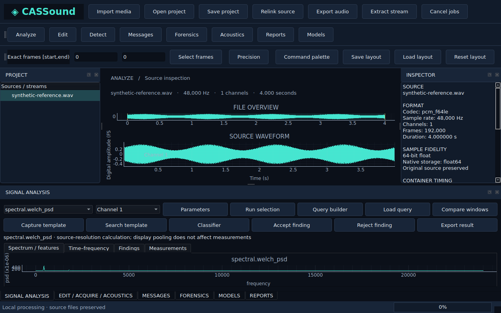

<p align="center"></p>

# CASSound

**See the signal. Find the pattern. Preserve the evidence.**

CASSound brings audio editing, scientific signal analysis, acoustic measurements, audio forensics, and encrypted messages in sound into one local desktop and Python workbench. Follow a recording from its original samples to a spectrum, a detected event, a processed revision, a recovered packet, and a reproducible report.

Built for people who move between sound, physics, and security: researchers, students, audio engineers, forensic examiners, and signal-processing developers.



## One recording, many ways to understand it

- **Inspect sound and video audio:** choose actual container streams, retain source timestamps, and access native integer PCM without silently reducing 24/32-bit samples to float32.
- **Measure the signal:** waveform, FFT magnitude/phase, Welch PSD, spectrogram, peaks, harmonics, energy, RMS, loudness, pitch/formants, spectral features, wavelets, CQT/mel, reassignment, synchrosqueezing, coherence, cepstrum and bicoherence.
- **Turn questions into findings:** combine frequency, amplitude, prominence, duration and channel conditions. Save detector recipes; review source-time annotations; search templates and fitted patterns.
- **Edit without replacing originals:** multitrack clips, cut/split/trim, gain, fades, automation, routing, EQ/filtering, dynamics, time/pitch changes, convolution, spectral masks and restoration. Keep revisions, history, residual comparisons and coordinate mappings.
- **Connect digital samples to acoustics:** generators, user reference calibration, pressure/SPL calculations, environmental models, transfer/impulse responses, room decay and distortion measurements with explicit assumptions.
- **Explore messages inside audio:** AES-256-GCM, password-derived or raw-file keys, native PCM LSB, FSK, PSK/QAM, chirp, spread, echo, phase and transform profiles; synchronized extraction, error correction, bit planes, symbol/sample mapping and seeded channel sweeps.
- **Examine rather than guess:** source/derivative hashes, alignment and gain fitting, null residuals, spectral differences, discontinuity/change candidates, ENF traces with supplied-reference matching and recorder-feature comparisons.
- **Run models locally on CPU:** GTCRN speech denoising, AudioSeal 16-bit watermark insertion/detection, wav2vec2 deepfake scores, fitted NMF spectral-factor separation and delayed prediction dereverberation. Offline packs have pinned weights and bundled notices; no model repository Python executes.
- **Share inspectable results:** JSON, CSV, Parquet, PNG, SVG, PDF and HTML exports; portable projects; a headless Python API and CLI; Studio and Precision themes, dock layouts, exact frame selections and a command palette.

The useful connection is the workflow: measurements and findings stay attached to a source revision, while desktop and scripted work share the same services. CASSound does not require a cloud account or a GPU. Explicit model fetching is separate from offline use.

## Where CASSound fits

| Established tool | Its focus | Why add CASSound to your toolkit? |
|---|---|---|
| [Audacity](https://www.audacityteam.org/) | General audio editing and effects | Connect edits with scientific queries, source provenance and message experiments |
| [Sonic Visualiser](https://www.sonicvisualiser.org/features.html) | Layered visualization and annotations | Carry findings into processing, acoustic, forensic and communications workflows |
| [Praat](https://www.fon.hum.uva.nl/praat/) | Speech and phonetic measurement | Put speech features alongside broader transforms, detection and forensic comparisons |
| [Room EQ Wizard](https://www.roomeqwizard.com/features.html) | Acoustic/system measurements | Combine calibrated file analysis with programmable signal investigation |
| [iZotope RX](https://www.izotope.com/pages/rx-for-content) | Professional audio restoration | Inspect methods and provenance, reuse the Python core, and investigate encoded signals |

These products have substantial overlapping capabilities and mature specialist workflows. CASSound offers an open, connected laboratory; this comparison does not assert unmeasured speed, restoration quality or forensic superiority.

## Install

Python **3.12+**. The intended desktop target is **Windows 11 x64**; Linux is also used for development checks.

```powershell
python -m venv .venv
.venv\Scripts\Activate.ps1
python -m pip install ".[full]"
cassound gui
```

For reproducible development, install `uv` and use `uv sync --frozen --extra full --extra dev`. For headless use, install the base package without Qt. Optional groups: `desktop`, `audio`, `features`, `models`, `reports`, and `full`. Install FFmpeg/ffprobe separately and place them on PATH for broad media/video import and codec sweeps. Normal use needs neither Rust nor Node.js.

Windows application bundles include **CASSound.exe** for the desktop and **CASSoundCLI.exe** for scripts, with their shared runtime beside them. Keep the bundle intact when using the portable distribution; installing Python is not required for the bundled executables. Offline model packs and FFmpeg remain separate installations.

See [BUILDING.md](BUILDING.md) for wheel, Windows executable, installer and native VST3 build instructions.

## Start exploring

1. Import audio or video and choose its stream.
2. Select a source region. Use **Analyze** for measurements, **Detect** for rules/findings, and **Edit** for a new processing revision.
3. Open **Messages**, **Forensics**, **Acoustics** or **Models** for their connected workflows.
4. Export from **Reports** and save a portable project when you want source samples included.

`Ctrl+K` opens the action palette. Studio provides a dark cyan/amber visual system; Precision provides a light high-contrast alternative. Exact frame bounds use `[start, end)`.

```python
from cassound import Session, Region, AnalysisSpec

with Session("my-analysis-cache") as session:
    imported = session.import_media("recording.wav").wait()
    revision = session.revision(imported.revision_id)
    region = Region(revision.revision_id, 0, revision.frames, (0,))
    result = session.analyze(region, AnalysisSpec("spectral.welch_psd")).wait()
    session.export_result(result.result_id, "spectrum.svg").wait()
```

```powershell
cassound doctor
cassound tasks
cassound analyze recording.wav --task spectral.peaks
cassound message-encode payload.bin message.wav --carrier qpsk
cassound message-decode message.wav recovered.bin --carrier qpsk
```

Passwords are prompted interactively. `--key-file` accepts exactly 32 raw bytes. Use `cassound lab --help` for isolated comparison, reference matching, microscope and channel tasks. [USER_GUIDE.md](docs/USER_GUIDE.md) documents parameters and examples.

## Offline models

Install the supplied `.casp` files through **Models → Install offline pack**, or:

```powershell
cassound model-install gtcrn.casp
cassound model-inventory
cassound model-run gtcrn speech.wav --output denoised.wav
```

To reproduce the packs from pinned upstream files, run `python tools/fetch_models.py model-packs`. Weights stay outside source/wheel archives and ordinary git history. Each pack includes its model card and license. See [model catalog](src/cassound/resources/model-catalog.json) and [validation record](docs/RELEASE_VALIDATION.md).

## Practical boundaries

Dense editing, communications and forensic operations are bounded to **8,000,000 scalar samples per input array**; model input is additionally bounded to 1–600 seconds after 16 kHz conversion (AudioSeal: at most 30 seconds). Long-file waveform/streaming analysis uses separate disk-backed paths. Format support depends on the actual libsndfile and FFmpeg build.

Carrier survival depends on the profile and transformations. Host echo/phase/spread/transform methods modify real audio and add a synchronization prefix; synthesis profiles create new signals. LSB requires lossless sample preservation. A recovered packet is verified only after cryptographic authentication. A negative search does not establish that a file contains no hidden data.

Forensic candidates, profile distances and model scores are observations, not authenticity verdicts. ENF matching needs a suitable supplied reference. Deepfake scores are not calibrated probabilities. Fitted NMF components are not labeled speakers or instruments, and linear prediction is not a neural dereverberation model. Calibration depends on a valid reference and a matching acquisition chain; no metrology or forensic certification is claimed.

The VST3 host supports documented mono/stereo offline audio effects with generic parameters/state, latency/tails and crash quarantine. Instruments, sidechains and vendor editor embedding are outside its current host scope. Audio driver support depends on the installed PortAudio backend.

This source bundle is **1.0.0rc1**. Executed Linux checks and outstanding native Windows, device, DPI/accessibility and field-dataset qualification are recorded explicitly in [RELEASE_VALIDATION.md](docs/RELEASE_VALIDATION.md). Windows CI builds the executable and installer, then verifies the packaged application on a separate runner. Successful compilation alone is not runtime qualification.

## Extend and contribute

Add scientific tasks, render effects, trusted Python analysis extensions or isolated native effects using [EXTENDING.md](docs/EXTENDING.md). The guide covers contracts, units, coordinates, security, workers, reports and UI integration. Suggestions, reproducible issues, documented model adapters and test recordings with clear licenses are welcome. See [CONTRIBUTING.md](CONTRIBUTING.md) and [SECURITY.md](SECURITY.md).

CASSound code is Apache-2.0. Dependencies and model weights retain their own terms; see [THIRD_PARTY_NOTICES.md](THIRD_PARTY_NOTICES.md).
