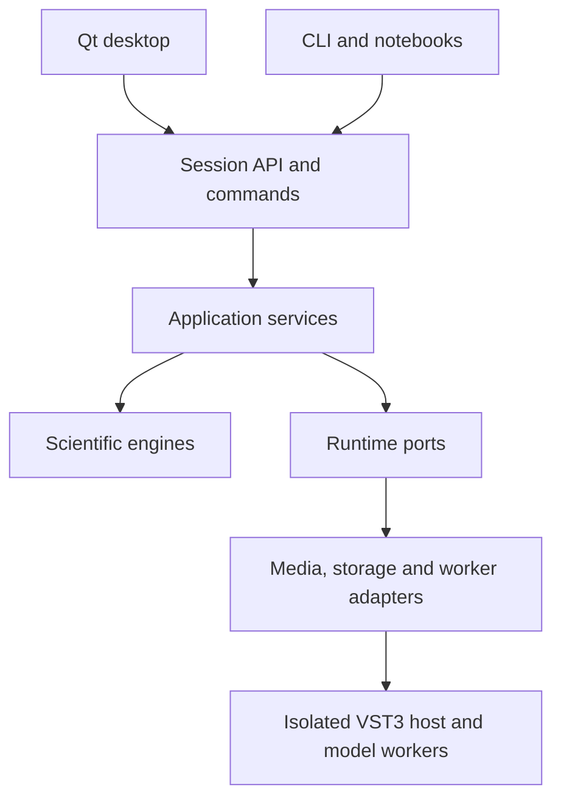

# Architecture and repository ownership

## Chosen design

A modular Python application with a headless public API, Qt desktop client, background workers and a narrowly scoped native VST3 helper. Use a single repository and distribution initially. Six work packages own groups of files; they do not require six independent services or repositories.



The diagram describes runtime roles. Import dependency rules are stricter: domain imports no GUI/backend modules; engines import domain and numerical dependencies; application imports domain and declared ports; runtime adapters implement ports and may invoke engines in workers; bootstrap wires implementations together. Desktop imports public API/contracts, never media parsers or engine internals. `api.py` lazily creates the default bootstrap so importing `cassound` does not initialize Qt, devices or workers.

## Planned repository tree

Paths below are implementation targets, not source files already present in this planning archive. Group related operations in cohesive modules; split only when responsibility or size warrants it. Tests can be more granular than production modules.

```text
CASSound/
  pyproject.toml
  README.md
  LICENSE
  THIRD_PARTY_NOTICES.md
  SECURITY.md
  CONTRIBUTING.md
  CHANGELOG.md
  CITATION.cff
  uv.lock
  src/cassound/
    __init__.py
    __main__.py
    api.py
    bootstrap.py
    cli.py
    domain/
      types.py
      commands.py
      events.py
      protocols.py
      errors.py
      units.py
    application/
      services.py
      project.py
      history.py
      capabilities.py
    engine/
      registry.py
      dsp.py
      features.py
      detection.py
      patterns.py
      editing.py
      acoustics.py
      generation.py
      messages.py
      forensics.py
      models.py
      robustness.py
    runtime/
      media.py
      storage.py
      cache.py
      jobs.py
      worker.py
      playback.py
      models.py
      vst3.py
      reporting.py
    desktop/
      app.py
      window.py
      state.py
      actions.py
      theme.py
      plots.py
      timeline.py
      inspector.py
      workspaces/
        analyze.py
        edit.py
        detect.py
        messages.py
        forensics.py
        acoustics.py
        reports.py
      dialogs.py
    resources/
      themes/
      icons/
      illustrations/
      recipes/
      schemas/
  native/vst3_host/
    CMakeLists.txt
    src/main.cpp
    src/host.cpp
    src/protocol.cpp
    include/host.hpp
    vendor.lock.json
  contracts/
    command.schema.json
    project.schema.json
    examples/
  tests/
    unit/
    integration/
    gui/
    security/
    fixtures/
  benchmarks/
    long_files.py
    detectors.py
    payload_channels.py
    reference_signals.py
  tools/
    build_release.py
    verify_release.py
    fetch_models.py
    generate_fixtures.py
  packaging/
    desktop.spec
    installer.iss
    backends.lock.json
    models.lock.json
    support-matrix.json
  docs/
    user-guide.md
    developer-guide.md
    measurements.md
    message-formats.md
    validation.md
  .github/workflows/
    checks.yml
    windows-build.yml
    release.yml
```

P1 owns public contracts and runtime foundation; P2 scientific engines; P3 editing/acoustics/native host; P4 messages/forensics/models; P5 desktop/resources; P6 release infrastructure. A shared file such as `services.py` is extended through a reviewed command registry instead of duplicated service layers.

## Data model

| Object | Meaning and invariants |
|---|---|
| Asset | Immutable source identity, SHA-256, original relative/absolute locator, probe snapshot and decoder reference |
| Stream | Selected source media stream, native rate/layout/sample format and timestamp origin |
| Revision | Immutable derived audio identity; parent operation graph, output spec and mapping to parents |
| Region | Half-open frame interval `[start_frame,end_frame)` and explicit channels on one revision |
| Operation | Versioned algorithm ID, validated parameters, ordered inputs, output spec and deterministic seed if needed |
| TimeMap | Piecewise mapping from output frames to parent frames; can have gaps, overlap or multiple parents |
| Measurement | Value/array reference, unit, normalization, support region, algorithm metadata, calibration and validity |
| Finding | Region, optional frequency bounds, typed measurements, detector score semantics and reviewer status |
| Artifact | Immutable exported audio/table/plot/report or cached intermediate identified by digest |
| Calibration | Device chain, reference reading, gain settings, frequency corrections, environment and validity limits |
| Job | Request ID, state, progress, inputs/revision, result references and typed failure |
| ModelSpec | Weight digest, license, task, input/output contract, preprocessing, version and runtime requirement |

Frames count time positions, not individual channel samples. Arrays presented internally by the public core use `(frames,channels)` with explicit dtype/rate. Adapters convert to a library/model's expected layout at the boundary. Integer sample access preserves packing/endian/valid-bit interpretation; no float round trip for bit-plane work.

Synthetic inputs, mixed tracks and generative transformations may not map to one original sample. The UI must display that fact. For nonlinear time changes retain the actual mapping or a documented approximation with error; never claim a simple offset is exact.

## Execution and memory

The Qt main thread handles interaction and rendering only. `JobManager` runs decoding, transforms and inference outside it, using a bounded pool of spawned Python worker processes. Use Windows-safe main guards and freeze support; child entry points live in importable modules. Some frozen-process start modes require a different launcher, so test the exact packaging tool early rather than assuming source-mode multiprocessing will work unchanged.

Control messages use versioned JSON envelopes. Large arrays travel through controlled memory-mapped cache files or managed shared-memory references, not base64 or JSON arrays. For source operations, workers receive source IDs and bounded regions. They resolve paths through the application store. Built-in worker launch machinery is trusted code; external project/plugin messages must never trigger arbitrary Python deserialization or imports.

Job lifecycle: queued → running → succeeded/failed/cancelled. Cancellation is cooperative at bounded block boundaries, then escalates only to the dedicated worker if necessary. Timeouts, worker death and partial output have explicit states. Write job outputs to staging and promote atomically only after successful validation. GUI state includes revision/request identity so stale job events cannot replace newer results.

Default proposed budgets on a 16 GB reference machine: application cache-memory budget 1 GB, worker aggregate target 2 GB with configurable admission control; never a separate unconstrained 2 GB allowance per worker. Disk cache gets an explicit quota and LRU policy. These are design targets to test, not achieved benchmarks. Large ML workers declare independent measured requirements; reduce concurrency before exhausting memory.

Full-file waveform overview uses min/max envelope pyramids. Spectrogram tiles and frequency slices are requested for visible regions/resolutions and cached by analysis identity. Measurement algorithms always read source-resolution samples, independent of plotting decimation. Full precision remains available at sample zoom. Audio data above display bounds is clipped visually only, never altered silently.

## Playback and recording

One transport clock drives cursor display. Playback receives pre-rendered blocks through bounded buffers; it does not run inference, disk scans or long transforms in callbacks. Keep underrun/overrun counters visible. Use tested Windows host APIs; loopback and ASIO require verified backend capability and configuration. Do not imply all PortAudio builds expose every Windows capture mode.

Track recording start position, device rate, requested/actual latency, dropped frames and host API. Align multi-device data only with a measured reference; separate device clocks can drift. Live analysis may have lower resolution and declared delay; offline rerun remains available.

## Nondestructive edit graph

Operations produce immutable revisions. A project stores clips/tracks, source selections, ordering, effects and automation. A render planner resolves block requests through the DAG, accounts for filter state, delay, tails, overlapping clips and rates, then applies export quantization/dither. Feedback loops are invalid. Undo changes project graph pointers; it does not overwrite source samples.

Distinguish real-time-capable effects from offline effects in the registry. Offline processing may generate a cached proxy for audition. A plugin's reported delay/tail enters the same render accounting. Original/processed/residual comparisons require alignment and documented gain matching.

## Project and cache storage

User project extension: `.cassound`, a validated ZIP bundle written atomically. It contains `manifest.json`, `state.sqlite`, annotations/recipes/calibrations, optional embedded sources, and an artifact inventory. External sources are referenced by hash and relinkable location. SQLite is checkpointed/closed before bundling. Large caches are adjacent/application-managed, disposable and excluded by default. "Save portable project" explicitly embeds selected sources after a size check.

User data lives in OS user application-data locations; no writes to installed program directories. Archives reject traversal, symlinks, excessive expansion, duplicate/conflicting paths and unbounded object counts. JSON and SQLite are data only; do not use pickled project objects. Migrations run on a copy and preserve the prior version until a successful save.

Cache key includes source digest, stream, revision/operation graph, region, algorithm version, all relevant parameters, sample spec, calibration/model digest and declared numerical backend. Uncacheable/nondeterministic operations are labeled, with seeds where possible. Machine paths and wall-clock timestamps are not scientific identity.

## Plugin and model boundaries

Analysis plugins register versioned tasks and declared parameter/output schemas. They are user-installed code, explicitly trusted; discovery does not execute arbitrary project-supplied entry points. Run untrusted-compatible extensions in isolated processes, while recognizing that process separation alone is not a full OS security sandbox.

The C++ host implements scan/open/configure/process/save-state/close through bounded local IPC. Scan each external plugin in a disposable process with timeout and quarantine. Log plugin identity/version, supported buses and state digest. Vendor editor embedding is excluded from the bounded host; generic controls are sufficient for declared scope.

Model adapters declare resampling/channel normalization, windowing, output time resolution, score meaning and license. Model import verifies digests and allowed formats; avoid arbitrary pickle execution. Downloading is explicit and can be replaced by offline model-pack installation. Store no original audio in model telemetry; there is no automatic cloud inference.

## Dependencies and packaging policy

Core: NumPy/SciPy and narrowly selected I/O/serialization dependencies. Domain dataclasses/protocols use the standard library; boundary validation may use a schema library pinned by the implementation. Desktop extra: PySide6/PyQtGraph. Scientific extras: librosa, selected wavelet implementation, loudness tools, scikit-learn. Messages: cryptography and evaluated ECC. Models: ONNX Runtime where supported, otherwise a compatible pinned PyTorch worker.

Full desktop release includes the entire feature code and essential tested runtimes. Model weights may ship as a separate offline pack with an obvious installer and capability inventory; this is packaging separation, not a later release. Python users may choose extras to avoid installing the GUI/ML stack. Provide `cassound[full]` to select all declared Python extras; it cannot by itself promise third-party weights or system media executables unless distributed lawfully.

Default executable build plan: PyInstaller one-directory bundle plus Inno Setup installer; validate against Qt's deployment route if PyInstaller fails the worker/model tests. Freeze one tested route in P1 and maintain it. Do not distribute a fragile single-file extraction executable merely to reduce the visible file count.

## Sources supporting platform choices

- Qt docking: https://doc.qt.io/qtforpython-6/PySide6/QtWidgets/QDockWidget.html
- Python process model: https://docs.python.org/3/library/multiprocessing.html
- Qt deployment: https://doc.qt.io/qtforpython-6/deployment/deployment-pyside6-deploy.html
- PyQtGraph: https://github.com/pyqtgraph/pyqtgraph
- VST3 SDK and current license: https://github.com/steinbergmedia/vst3sdk
- VST3 license transition: https://steinbergmedia.github.io/vst3_dev_portal/pages/VST%2B3%2BLicensing/VST3%2BLicense
- FFmpeg redistribution/build terms: https://www.ffmpeg.org/legal.html

These sources justify available mechanisms, not the performance or correctness of a future CASSound build. Pin the exact SDK/library commits and audit the actual distributed files.
